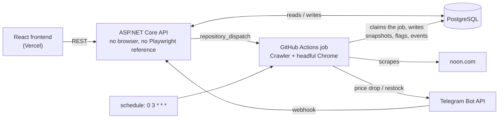
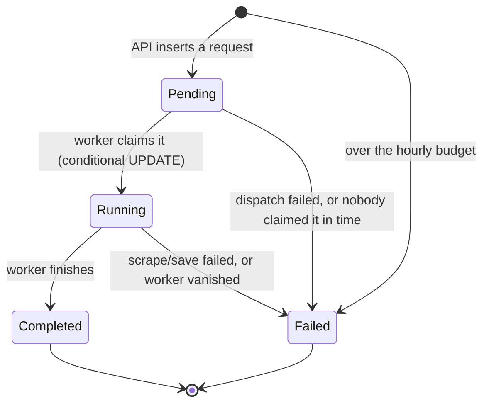
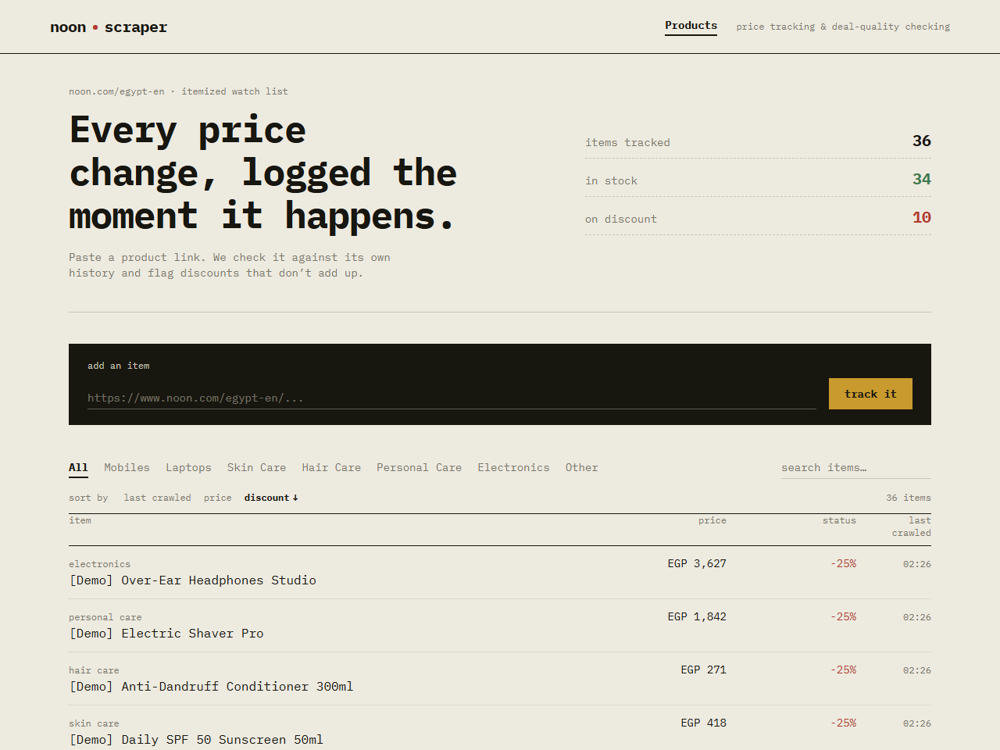
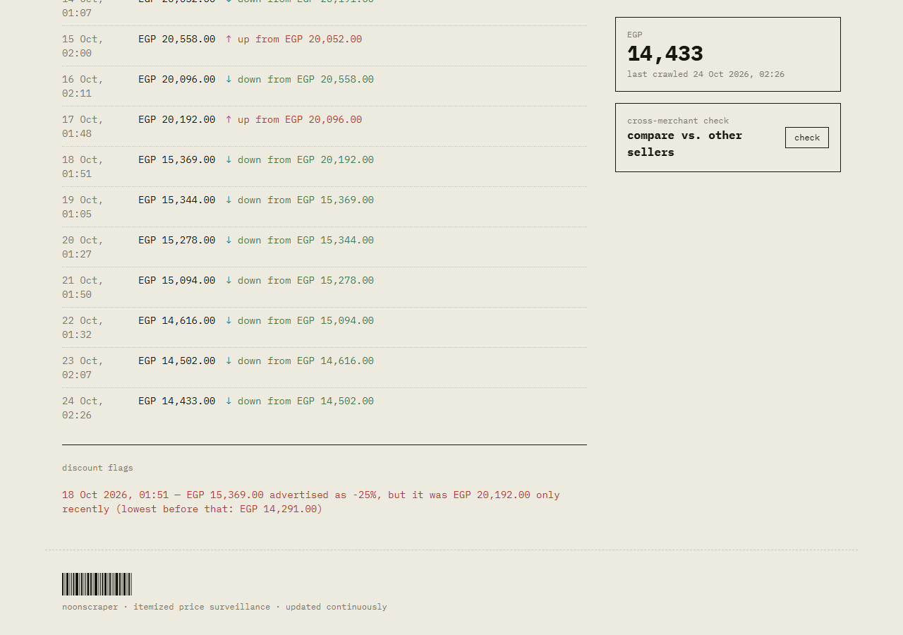
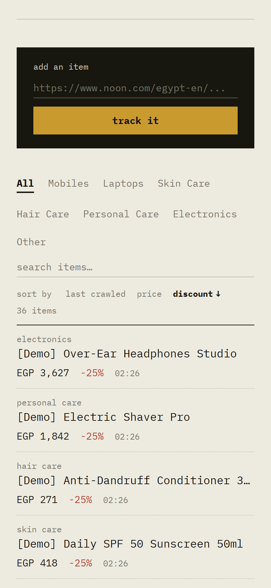

# Noon-Scraper

Price tracking and discount verification for [noon.com](https://www.noon.com): it keeps every price it sees, then checks whether an advertised "discount" holds up against the product's own price history. Built with ASP.NET Core, PostgreSQL, Playwright and GitHub Actions.

[](https://github.com/alieldeenahmed/Noon-Scraper/actions/workflows/ci.yml)
[](https://github.com/alieldeenahmed/Noon-Scraper/actions/workflows/daily-crawl.yml)


[](LICENSE)

> An independent personal learning project. It is not affiliated with, endorsed by, or connected to Noon. See [Responsible use](#responsible-use).

The interesting part isn't fetching a page. It's the backend around it: background jobs that run on an unreliable trigger (GitHub Actions), so job coordination, concurrency control and input validation are done in the database and tested against a real PostgreSQL. [Engineering highlights](#engineering-highlights) has the details, each linked to the code and the test that proves it.

## Live demo

**Frontend:** <https://noon-scraper-phi.vercel.app> · **API:** a free-tier Back4app container whose URL changes whenever it is recreated (current one in [`Backend/README.md`](Backend/README.md); history in [`Backend/docs/hosting.md`](Backend/docs/hosting.md)).

> **State when this was last checked (2026-10-24):** the frontend loads, but the API container returned `404` for every endpoint, so the page shows "Couldn't reach the API". The database and the scheduled crawl were unaffected. If the demo looks empty, run it locally with the synthetic data below.

| Works on the live demo (while the API container is up) | Needs a local run |
|---|---|
| Browse, search, filter, sort and page the tracked products | Seeded **synthetic** demo data (the live database holds real scraped data) |
| Price history, flagged fake discounts, restock history | The test suites |
| Submit a noon.com product link; it is crawled by a GitHub Actions job and the page shows its real state, including why it failed | Running the crawler yourself (needs a real Chrome and a display) |
| "Check now": a live cross-seller price comparison, run as a GitHub Actions job | Your own Telegram bot (token, webhook secret and registration are yours to configure) |
| The daily crawl, which runs on a GitHub Actions schedule whether or not the API is up | Your own GitHub token for dispatching jobs, if you fork it |

## What it does

- Keeps every observed price as an append-only history instead of overwriting the latest one.
- Flags a discount as suspect when the product's price quietly spiked before the "sale" and the sale price still doesn't beat its recent low.
- Detects restocks, and can message a Telegram chat when a tracked price drops or an item comes back.
- Crawls five category pages daily, plus any product a visitor submits by link; each crawl is a job with a state you can look up.
- Compares sellers for one product on demand.

## Engineering highlights

**1. The database decides who runs a job, so duplicate triggers are harmless.** GitHub Actions can deliver a `repository_dispatch` twice, late, or not at all, and offers no way to ask whether anyone picked one up. A request is therefore a row with a state machine (`Pending → Running → Completed | Failed`), and every transition is one conditional `UPDATE` (this is the shape of what EF Core generates):

```sql
UPDATE "ProductCrawlRequests" SET "Status" = 3 /* Running */, "StartedAt" = @now
WHERE "Id" = @id AND "Status" = 0 /* Pending */;   -- 1 row: you own the job. 0 rows: someone else does.
```

Code: [`JobLifecycle.cs`](Backend/NoonScraper.Data/JobLifecycle.cs) · proof: `Concurrent_claims_have_exactly_one_winner` ([`JobLifecycleTests.cs`](Backend/NoonScraper.Tests/JobLifecycleTests.cs)), `Two_workers_started_at_once_scrape_once` ([`DispatchedJobTests.cs`](Backend/NoonScraper.Tests/DispatchedJobTests.cs)). Requests nobody finishes are expired to `Failed` with a stage and a public-safe message (after 15 minutes by default), so a lost dispatch or a dead worker can't leave a request stuck or block the product. **What it does not do:** a lost dispatch is not redelivered — a real queue would; here it is detected, reported, and the daily crawl covers tracked products.

**2. Concurrency is enforced by the database, not hoped for.** Partial unique indexes allow one active (`Pending`/`Running`) request per product and one running scheduled crawl ([`AppDbContext.cs`](Backend/NoonScraper.Data/AppDbContext.cs)). Recording a price reading runs in one transaction behind a PostgreSQL advisory lock keyed on the product URL (`pg_advisory_xact_lock`, [`ProductRecorder.cs`](Backend/NoonScraper.Crawler/ProductRecorder.cs)), so two overlapping crawls of one product record one restock, not two. The lock covers those writes only; the API's product insert is arbitrated by a unique index instead. Proof: `Concurrent_submissions_of_one_product_create_it_once`, `Concurrent_crawls_record_a_restock_only_once`, `Two_runs_started_together_are_one_run_and_one_skip`. Diagrams and exact scope: [`docs/ARCHITECTURE.md`](docs/ARCHITECTURE.md).

**3. User-supplied URLs are validated before a browser ever visits them.** [`NoonUrl.cs`](Backend/NoonScraper.Data/NoonUrl.cs) accepts only `https` links whose host, in its punycode form, is exactly `noon.com` or `www.noon.com` (an earlier `EndsWith("noon.com")` accepted `evilnoon.com`). It rejects userinfo, ports and invisible Unicode characters, and checks the path as the user wrote it, because `Uri` silently percent-encodes characters like `<` and `"` before a normalized path can be inspected. The crawler only visits the canonical URL rebuilt from the parsed parts. This is an allow-list that stops the submission endpoint from pointing the crawler's browser elsewhere; it does not inspect IP addresses or control redirects. Proof: [`NoonUrlTests.cs`](Backend/NoonScraper.Tests/NoonUrlTests.cs).

**4. Two layers of limits, because they defend different things.** The in-process rate limiter ([`RateLimiting.cs`](Backend/NoonScraper.Api/Services/RateLimiting.cs): 300 requests/min per IP, 5/min per IP and 30/min combined on the endpoints that start a workflow) resets on restart, is per instance, and trusts a client IP that behind a proxy comes from a forgeable header. The limits that protect the metered GitHub Actions quota are counted from database rows ([`JobRequestService.cs`](Backend/NoonScraper.Api/Services/JobRequestService.cs): 30 dispatches/hour, 20 new products/hour, 500 user-added products) and read no header at all.

**5. Discount verification is a plain, explainable rule over stored history.** A discount is flagged when the product advertises one **and** within the last 90 days the most recent prior price was at least 1.1× the lowest price in that window **and** today's price is not below that low — i.e. the "before" price was an inflated recent spike. The flag stores the numbers it was based on. Code: [`PriceHistoryAnalyzer.cs`](Backend/NoonScraper.Data/PriceHistoryAnalyzer.cs) · tests: `PriceHistoryAnalyzerTests`. It needs at least one prior snapshot in the window, so a new product is never flagged, and it only knows prices this system has itself crawled.

**6. A failing item doesn't take the run down.** The daily crawl treats each category and product as its own unit: a failure is caught, counted and logged, each reading commits on its own, the run has a time budget, and the workflow turns red on an explicit policy rather than "green unless it crashed" ([`DailyCrawl.cs`](Backend/NoonScraper.Crawler/Jobs/DailyCrawl.cs), [`failure-model.md`](Backend/docs/failure-model.md)).

## Architecture





The API and the crawler never call each other; they share the database, and only a request id crosses from one to the other. The API has no Playwright reference anywhere (the deployment has no browser), and the crawler runs only inside GitHub Actions. More: [`docs/ARCHITECTURE.md`](docs/ARCHITECTURE.md) and [`Backend/docs/`](Backend/docs).

## Screenshots

Captured from a local run against **synthetic demo data** — every product shown is invented ("[Demo]" prefix) and nothing was scraped to produce these. They show behaviour, not real prices.

**The list, sorted by discount:**



**A flagged fake discount.** The price sat near 14,400, quietly rose to about 20,200, then a "-25%" sale landed at 15,369 — still above the old low of 14,291, so the rule flags it:





More in [`docs/screenshots/`](docs/screenshots) (a restock example, and how they are regenerated).

## Tech stack

| | |
|---|---|
| Backend | ASP.NET Core (.NET 9), C#, EF Core + Npgsql |
| Database | PostgreSQL (Neon in the deployment) — partial unique indexes, advisory locks, migrations |
| Browser automation | Playwright for .NET driving headful Chrome under `xvfb` |
| Automation | GitHub Actions: `schedule` and `repository_dispatch` workflows, plus CI |
| Frontend | React 19, TypeScript, Vite, Tailwind CSS v4; API responses validated at runtime with `zod` |
| Testing | xUnit against real PostgreSQL, `WebApplicationFactory`, Playwright (scraper tests on saved markup); Vitest + React Testing Library |
| Hosting (demo) | Back4app (API, Docker), Vercel (frontend), Neon (database) — all free tiers |

## Getting started

**You need:** [.NET 9 SDK](https://dotnet.microsoft.com/download), Node.js 22+, and PostgreSQL 17+ (the compose file provides it if you have Docker). To run the crawler itself you also need a Linux/WSL session with a display and Google Chrome; the API, frontend and tests do not.

### Run it with synthetic demo data

```bash
# 1. Database (Docker). Or point step 2 at any empty PostgreSQL you can reach.
docker compose up -d db

# 2. Apply the migrations and load the synthetic data (36 invented products, 70 days of history).
#    Defaults match docker-compose.yml; pass a connection string as the first argument to use another database.
dotnet run --project Backend/NoonScraper.DemoData

# 3. API on http://localhost:5176 (the connection string is passed on the command line, so nothing is stored on your machine)
dotnet run --project Backend/NoonScraper.Api -- --ConnectionStrings:DefaultConnection="Host=localhost;Port=5432;Database=noonscraper;Username=noon;Password=noon_dev_only"

# 4. Frontend on http://localhost:5173 (new terminal)
cd Frontend
cp .env.example .env
npm install
npm run dev
```

The seeder refuses to run against a database that holds any non-demo product. Without a GitHub token the API still works, but a submitted link's crawl is recorded as failed at stage `dispatch` (the product is still saved). To run the API and database together in Docker instead: `docker compose --profile app up --build`. *I wrote and reviewed the compose file, but Docker isn't installed on my development machine, so that one path hasn't been run by me; the steps above were.*

### Run the tests

```bash
cd Backend && dotnet test                   # first run downloads an embedded PostgreSQL 17; scraper tests need Chrome
dotnet test --filter "Category!=Browser"    # without the Chrome-driven scraper tests
cd ../Frontend && npm test
```

Set `NOON_TEST_POSTGRES` (a connection string with rights to create databases) to use an existing server instead of the embedded one; CI does this with a service container. Every setting the backend reads is documented in [`Backend/.env.example`](Backend/.env.example).

### Run it against real data

Needs a PostgreSQL database (`dotnet ef database update --project Backend/NoonScraper.Data --startup-project Backend/NoonScraper.Api`), the crawler run from a Linux session with Chrome (`dotnet run --project Backend/NoonScraper.Crawler`), and for the GitHub-triggered flows a `DATABASE` repository secret plus a fine-grained token for the API. Details: [`Backend/README.md`](Backend/README.md), [`Frontend/README.md`](Frontend/README.md), [`Backend/docs/hosting.md`](Backend/docs/hosting.md).

## Testing

**699 backend tests** (xUnit; counted with `dotnet test --list-tests`) and **89 frontend tests** (Vitest). Of the backend tests, 645 run without a browser, 54 drive a real Chrome against saved markup, and **360 use a real PostgreSQL** — the rest are pure unit tests. CI runs the suite on every push to `main` and every pull request that isn't docs-only, against a PostgreSQL service container.

Real PostgreSQL matters because the claims above are about things an in-memory fake doesn't enforce: unique and partial indexes, advisory locks, foreign keys, transactions, concurrent writers. Thirteen tests are explicit concurrency tests (concurrent claims, simultaneous submissions, overlapping crawls, two scheduled runs started together), each asserting that exactly one party wins. Others provoke each index and cascade directly, apply the latest migration to a database holding representative legacy rows, attack the URL validator (look-alike hosts, userinfo, ports, zero-width characters, path tricks), and check the Telegram webhook against hostile payloads.

Honest limits: the scraper fixtures are static snapshots, so they catch a regression in my parsing but cannot notice Noon changing its live markup; the frontend tests run in jsdom, not a real browser; coverage isn't measured. See [`Backend/docs/scraper-testing.md`](Backend/docs/scraper-testing.md).

## Responsible use

This is a personal project for learning backend engineering. It is **not** affiliated with or endorsed by Noon, and I have not asked Noon's permission. Please don't use it to put load on their site.

What the code actually does to keep its footprint small: it visits only products that are tracked (five category pages and individual product pages, not the catalogue); the scheduled crawl runs once a day, sequentially, in a single browser tab, with a 15-minute time budget; scrapes retry at most once, with a 3-second pause; and user-submitted links are limited to noon.com product pages, with caps of 30 triggered jobs and 20 new products per hour and 500 user-added products in total.

What it does **not** do: it doesn't read or obey `robots.txt`, it doesn't pause between products, it uses Chrome's default user agent, and the browser is configured to hide common automation signals ([`StealthBrowser.cs`](Backend/NoonScraper.Crawler/StealthBrowser.cs)) because the site blocks plain automated browsers. I make no claim that this complies with Noon's terms of service; whether and how to run it against their site is the operator's responsibility.

## Limitations

- **Depends on a site that resists automation.** The daily crawl is sometimes blocked: the run on 2026-10-16 failed all five categories and the next day's failed one (I have the counts, not the pages, so "blocked" is my inference); the five runs after that succeeded. A change in their markup would break parsing, and the saved-markup tests cannot detect it.
- **A lost dispatch isn't retried.** The request is expired and reported as failed after 15 minutes; the user resubmits, and the daily crawl covers tracked products.
- **GitHub schedules are approximate.** The 03:00 UTC cron has been starting roughly five hours late (between about 07:30 and 08:40 UTC in recent runs).
- **The demo's API is on a free tier** that gets recreated, so its URL changes and it can be down.
- **No authentication**, by design for a public demo: abuse is bounded by caps, not prevented, and anyone can use up the hourly budgets. The in-process rate limiter is per instance.
- **The fake-discount rule is a heuristic** over this system's own crawl history, not proof of anything; it can't judge a product it has barely seen.
- **Only one site, and only the first page of each category.**
- **Not independently reviewed or load-tested.**

Full list: [`Backend/docs/known-limitations.md`](Backend/docs/known-limitations.md).

## License

[MIT](LICENSE)
