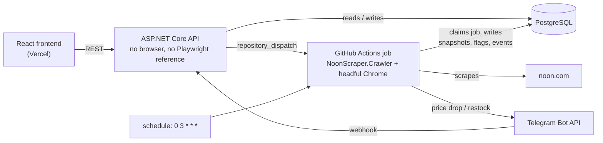
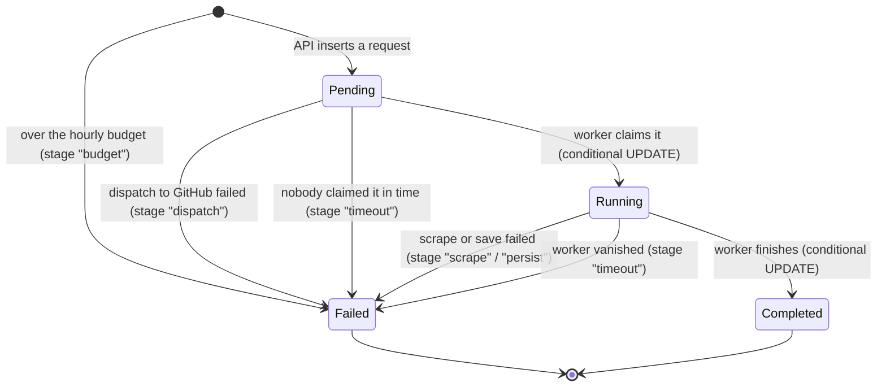

# Architecture

Three things in this system are easy to get wrong and are worth reading about: how a
background job is **claimed exactly once** even though GitHub Actions can deliver the same
trigger twice (or never), what the **advisory lock** does and does not cover, and what the
**URL validation** actually checks before the crawler's browser is allowed to visit anything.

Every statement below names the file that implements it. The longer write-ups this page
summarizes are in [`Backend/docs/`](../Backend/docs): [`architecture.md`](../Backend/docs/architecture.md),
[`failure-model.md`](../Backend/docs/failure-model.md), [`security-model.md`](../Backend/docs/security-model.md).

## Components



The API and the crawler never call each other. They share a database, and the only thing
that crosses from the API to the crawler is a request id in a `repository_dispatch` payload.

## Job lifecycle



`Failed` always carries a stage and a message that is safe to show publicly; the exception
itself goes to the log. Source: [`JobStatus.cs`](../Backend/NoonScraper.Data/Models/JobStatus.cs),
[`JobLifecycle.cs`](../Backend/NoonScraper.Data/JobLifecycle.cs),
[`JobRequestService.cs`](../Backend/NoonScraper.Api/Services/JobRequestService.cs).

## Claiming a job: why a duplicate delivery is safe

`repository_dispatch` is fire-and-forget. There is no delivery guarantee, no way to ask
whether anyone picked an event up, and a run can be re-run from the Actions UI. So the
database, not the workflow, decides who does the work.

```mermaid
sequenceDiagram
    autonumber
    participant U as Browser
    participant A as API
    participant DB as PostgreSQL
    participant G as GitHub Actions
    participant W1 as Worker 1
    participant W2 as Worker 2 (duplicate run)

    U->>A: POST /api/products {url}
    A->>A: NoonUrl.TryParse (see "URL validation")
    A->>DB: INSERT Product (unique index on Url)
    A->>DB: INSERT ProductCrawlRequest, Status = Pending
    Note over DB: partial unique index: at most one<br/>Pending/Running request per product
    A->>G: repository_dispatch {requestId, productId, correlationId}
    A-->>U: 201 Created (crawl: Pending)

    G->>W1: run "crawl-product <requestId>"
    G->>W2: same event delivered twice, or a re-run
    W1->>DB: UPDATE ... SET Status = Running WHERE Id = @id AND Status = Pending
    DB-->>W1: 1 row affected → this worker owns the job
    W2->>DB: the same UPDATE
    DB-->>W2: 0 rows affected → exit successfully, no scrape

    W1->>W1: scrape the product page
    W1->>DB: BEGIN; pg_advisory_xact_lock(hash(url)); find product; append snapshot;<br/>run restock + discount rules; COMMIT
    W1->>DB: UPDATE ... SET Status = Completed WHERE Id = @id AND Status = Running
    U->>A: GET /api/products/{id} (polling)
    A->>DB: read request status
    A-->>U: crawl: Completed
```

What each guard buys:

| Guard | Where | What it prevents |
|---|---|---|
| Partial unique index, one `Pending`/`Running` row per product | [`AppDbContext.cs`](../Backend/NoonScraper.Data/AppDbContext.cs) (`UX_ProductCrawlRequests_ActivePerProduct`, `UX_CheckNowRequests_ActivePerProduct`) | a double-click or two API instances creating two jobs for one product; the loser of the race is handed the winner's request |
| `UPDATE ... WHERE Status = Pending` | `JobLifecycle.TryClaimAsync` | two workers running the same request; the affected-row count says who won |
| `UPDATE ... WHERE Status = Running` (complete) and `WHERE Status IN (Pending, Running)` (fail) | `TryCompleteAsync` / `TryFailAsync` | a late worker marking `Completed` a request that was already expired and reported as failed; failing a request that already finished is a no-op |
| Expiry of stale requests | `JobLifecycle.ExpireStaleAsync`, run on every new request and at the start of every scheduled crawl; `JobLifecycle.View` applies the same rule at read time | a lost dispatch or a dead worker leaving a request `Pending`/`Running` forever, which would also block new requests for that product |
| Unique `Running` row in `CrawlRuns` | `UX_CrawlRuns_OneRunning`, handled in `DailyCrawl.cs` | two scheduled crawls running at once |

What it does **not** do: a dispatch that is lost is not redelivered. The request is expired
to `Failed` (default after 15 minutes, `Jobs:StaleAfterMinutes`) and reported as such; the
user can resubmit and the daily crawl covers tracked products. A real queue would redeliver.

## The advisory lock: scope

`ProductRecorder` ([`ProductRecorder.cs`](../Backend/NoonScraper.Crawler/ProductRecorder.cs))
records one reading of one product. Inside a single transaction it runs

```sql
SELECT pg_advisory_xact_lock(hashtextextended(@url, 0));
```

then finds or creates the product, checks the previous snapshot for a restock, appends the
new `PriceSnapshot`, runs the fake-discount rule against the saved history, and writes the
`RestockEvent` / `DiscountFlag`. It is a *transaction-scoped* lock: it is released at commit
or rollback, so a crash cannot leave it held.

- **What it serializes:** two crawls of the *same* product (the scheduled crawl and an
  on-demand one, or a retried job while its predecessor is still running). The second waits,
  then sees the first's snapshot, so a restock is recorded once and a discount is judged
  against history that includes the other crawl. Crawls of *different* products do not block
  each other (there is a test for that).
- **Why an advisory lock rather than a row lock:** for a product that does not exist yet there
  is no row to lock.
- **What it does not cover:** it is not "every write for a product". The API inserting a
  user-submitted product does not take it; the unique index on `Products.Url` decides that
  race, and the recorder retries once as an update if it loses it. Subscription writes and
  notification claims do not take it either; notifications are sent *after* the commit, each
  claimed with a conditional update first (`SubscriptionNotifier`), so two crawls cannot both
  send the same alert.
- **Lock ordering:** each operation holds at most one product's lock, so no ordering scheme
  between locks is needed.

## URL validation: what is checked before the browser visits anything

The crawler's browser must never be pointed anywhere except a noon.com product page, and the
API accepts a URL from the internet. [`NoonUrl.TryParse`](../Backend/NoonScraper.Data/NoonUrl.cs)
runs these checks in order and rejects at the first failure:

1. Present, at most 2048 characters.
2. No whitespace, control characters, or Unicode "format" characters (zero-width spaces and
   similar, which make two different strings look identical).
3. Parses as an absolute URL.
4. Scheme is `https`.
5. No userinfo (`https://noon.com@evil.example/...`).
6. Default port only.
7. Host, taken in its ASCII / punycode form (`Uri.IdnHost`), is exactly `noon.com` or
   `www.noon.com`. An allow-list comparison, not a suffix check: an earlier `EndsWith("noon.com")`
   accepted `evilnoon.com` (engineering log #16), and comparing the punycode form means a
   look-alike written in other scripts can never equal the real host.
8. The path is judged **as the user wrote it** (`RawPath`), not after `Uri` normalizes it —
   `Uri` quietly percent-encodes characters such as `<`, `>`, `"` and `|`, which would let
   them through a whitelist applied afterwards. It must have 3–5 segments, end in `/p`, have
   a product code of 2–64 alphanumerics, a market segment like `egypt-en`, and every segment
   limited to letters (any script), digits and a few punctuation marks.

After validation the crawler only ever visits the **canonical URL rebuilt from the parsed
parts** (`https://www.noon.com/<path>/`), never the string the caller sent. Query strings and
fragments are dropped, which also removes Noon's per-session tracking parameters so one
product is one row.

What this is and is not: an allow-list that prevents using the submission endpoint to point
the crawler's browser at an internal address or another site. It does not inspect IP
addresses, and it does not control redirects that noon.com itself might issue.

## Two layers of limits

| Layer | Where | Properties |
|---|---|---|
| In-process rate limiter: 300 requests/min per client IP, 3,000 combined; 5/min per IP and 30 combined on the two endpoints that start a workflow | [`RateLimiting.cs`](../Backend/NoonScraper.Api/Services/RateLimiting.cs) | resets on restart, per instance; the per-IP part trusts a client IP that, behind a proxy chain of unknown depth, comes from a forgeable `X-Forwarded-For` |
| Database-backed budgets: 30 dispatched jobs/hour, 20 new products/hour, 500 user-added products in total | [`JobRequestService.cs`](../Backend/NoonScraper.Api/Services/JobRequestService.cs), [`JobOptions.cs`](../Backend/NoonScraper.Api/Services/JobOptions.cs) | counted from rows, so they survive restarts, hold across instances, and read no header |

The second layer is what actually protects the metered GitHub Actions quota; the first is a
cheap filter in front of it.
